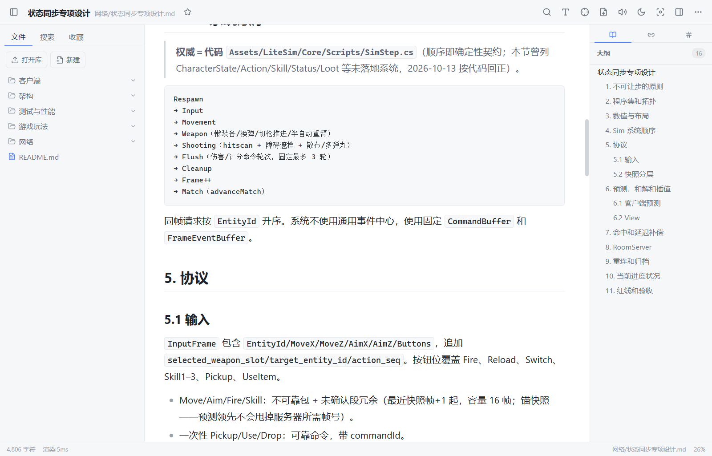
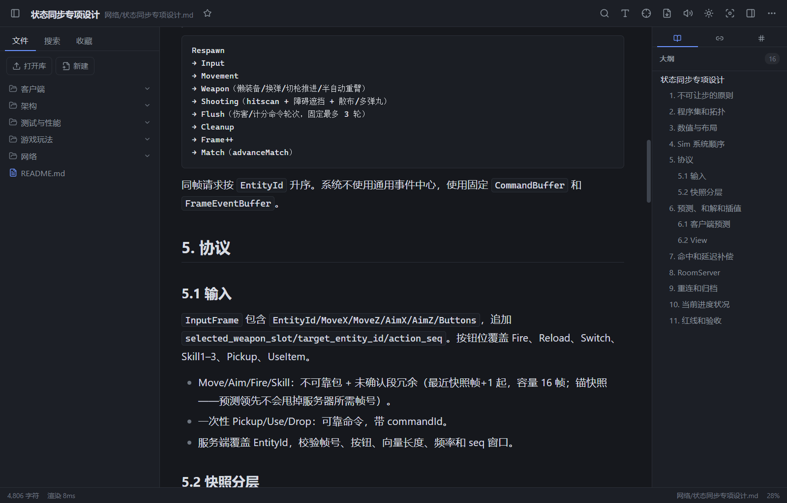

# WindMD

> 本地优先、高性能的 Markdown 阅读器 —— 接近 IDE 级的大文件性能,接近出版级的阅读体验。





## 特性

### 出版级渲染
- CommonMark 100% 兼容(官方 spec 652/652 通过),GFM 表格 / 任务列表 / 脚注
- KaTeX 公式、Mermaid 图表、Shiki 代码高亮(带一键复制)
- 万行文档 < 1s 可交互,10MB 级文件流畅

### 阅读体验
- 焦点行 / 打字机模式 / 字号与阅读宽度调节 / 阅读进度按文档记忆
- 系统音色朗读(TTS),逐句高亮并跟随视口
- 划词翻译:内置离线英汉词典(词形还原 / 短语 / 中文反查);在线翻译可选,**默认零网络请求**
- 21 项快捷键全部可在设置页重新绑定

### 知识库
- 侧栏文件树(新建 / 重命名 / 删除 / 右键菜单),选择目录即打开为库
- 双链 `[[文档]]`、`#标签`、收藏;反向链接与标签聚合面板
- 全库全文搜索(SQLite FTS5,带摘要与命中行号,万级库约 7ms)
- 文件监视自动增量索引(300ms 静默窗)

### 导出
- HTML / PDF / 长图,所见即所得

### 隐私与安全
- 纯本地:文档、索引、配置全部留在本机,无账号、无遥测
- 渲染内容经 DOMPurify 清洗后才挂载(XSS 闸门),`<script>` / `onerror` / `javascript:` 均被拦截

## 快速开始

环境要求:**Node 20+**、**Rust 1.77+**(Tauri 2)。

```bash
npm install
npm run tauri dev   # 开发模式;未安装 Tauri 桌面环境时会话自动回退到内置 mock 后端
```

## 文件关联

安装版会把 `.md` / `.markdown` / `.mdown` 注册为可打开类型:右键文件 →「打开方式」→ WindMD,
或在系统「默认应用」里设为默认。Windows 10/11 不允许安装器静默抢占默认应用,首次需要手动确认一次。

从文件关联打开时,WindMD 会把文件所在目录作为库(以便文件树、搜索与双链),并定位到该文件;
目录较大时首次会先建索引。应用已在运行时再次双击文档会复用当前窗口,不会多开进程。

## 构建与测试

```bash
npm run build                        # 前端构建(tsc + vite)
npm test                             # Vitest 全量测试
npm run tauri build                  # Tauri 构建
pwsh scripts/bundle-release.ps1      # 打出安装器(NSIS + MSI)
```

> Windows 上首次打包需要下载 NSIS/WiX 工具链;直连 GitHub 超时时脚本会自动走镜像
> (可用环境变量 `TAURI_BUNDLER_TOOLS_GITHUB_MIRROR` 覆盖),工具链缓存后即可离线打包。

产物位于 `src-tauri/target/release/bundle/`(NSIS 安装包 / MSI 安装包)。

## 快捷键

| 按键 | 功能 | 按键 | 功能 |
|---|---|---|---|
| `Ctrl+O` | 打开库 | `Ctrl+P` | 导出菜单 |
| `Ctrl+F` | 文档内查找 | `Ctrl+,` | 设置 |
| `Ctrl+Shift+F` | 全库搜索 | `J` / `K` | 下 / 上滚动 |
| `Ctrl+B` | 侧栏 | `G` `G` | 回到顶部 |
| `Ctrl+Shift+B` | 右侧面板 | `Shift+G` | 回到底部 |
| `Ctrl+E` | 切换主题 | `[` / `]` | 上 / 下一个标题 |
| `Ctrl+=` / `Ctrl+-` / `Ctrl+0` | 放大 / 缩小 / 重置字号 | `F` | 焦点行 |
| `S` | 朗读 | `T` | 打字机 |
| `Z` `Z` | 专注模式 | | |

## 技术栈

- **前端**:Vite 6 · React 18 · TypeScript(strict)· Zustand · Vitest
- **渲染**:markdown-it · Shiki · KaTeX · Mermaid · DOMPurify
- **后端**:Tauri 2 · Rust · SQLite(rusqlite bundled,FTS5)· notify(文件监视)
- **质量基线**:Vitest 451 + cargo test 86 全绿;首屏资源 347.8KB(350KB 红线内)

## 项目结构

```
src/                 前端(React)
  renderer/          渲染管线:markdown / highlight / math / mermaid / export / translate ...
  ui/                界面组件:Toolbar / Sidebar / Viewer / Outliner / SettingsPage ...
  store/             Zustand 全局状态
src-tauri/           Rust 后端(Tauri)
  src/               commands / db / indexer / search / watcher / tts / links ...
scripts/             构建脚本:make-icon.mjs(图标)/ bundle-release.ps1(打包)
tests/               Vitest 测试(含 CommonMark spec 652 例)
docs/                项目规划与执行计划
```

## 文档

- [项目规划](docs/项目规划.md) —— 产品定位、里程碑与验收标准
- [执行计划](docs/执行计划.md) —— 逐任务执行记录、踩坑与验证报告

## License

[MIT](LICENSE) © 2026 highhunter777
